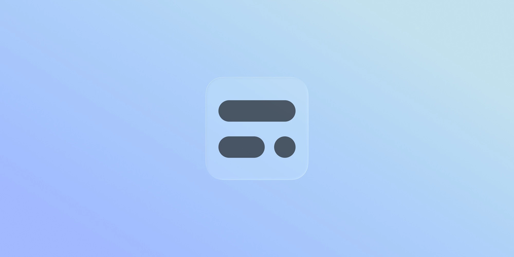
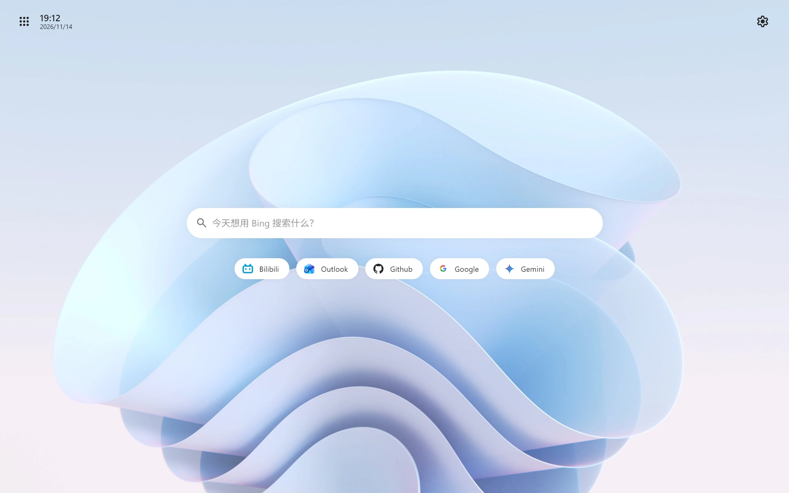

# Litestart 

<strong>删繁就简。这次就由 Litestart 带来顺滑、迅捷、轻盈的体验。</strong>

面向桌面浏览器可定制的类原生浏览器起始页

[<u>简体中文</u>] | <a href="docs/README_EN.md">English</a>

## 快速开始

从插件商店获取或是更新 Litestart 

&nbsp;&nbsp;

***

或者使用文件导入

1. 从 [Releases](https://github.com/XingYueFox/Litestart/releases) 下载最新的.zip文件（Firefox请使用.xpi）
2. 打开浏览器的扩展或者插件管理界面，然后启用开发人员模式
3. 将你下载的.crx或者.zip文件托入插件界面导入
4. 在插件列表找到Litestart启用
- ***请注意，如果无法启用请使用.zip导入***
- 需要帮助？在这里找到我们：949401995
***

## 关于Litestart

- 面向桌面浏览器可定制的类原生浏览器起始页
- 相比之下，这个页面没有无关紧要的在线内容，以更快的速度带来预置级体验
- 个性化，不牺牲速度。更多自定义，一样快

## 特色功能

- 搜索引擎、Logo、网站导航、搜索历史，乃至搜索框的位置，全都由你决定
- 自定义背景、搜索引擎以及布局
- 把常用的网站，固定在你想要的位置
- 或者，任何一张你喜欢的壁纸

## 适用范围

- **系统**：Windows 7以上 / macOS 10.15以上 / Linux 至少支持现代 GTK 3 的发行版
- **浏览器**：
  - Chrome / Edge：109及以上
  - Firefox：145以上
- **支持语言**：简体中文 / 繁體中文 / English / Русский / 日本語

## 重要声明
*Litestart 完全免费，请勿从来源不明的地方获取此插件，否则造成的一切后果自负！ 
*此网页/插件，仅用于学习、测试与自有设备调优。

## License

Apache 2.0 License
