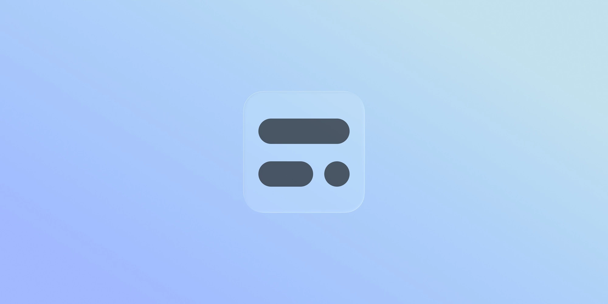
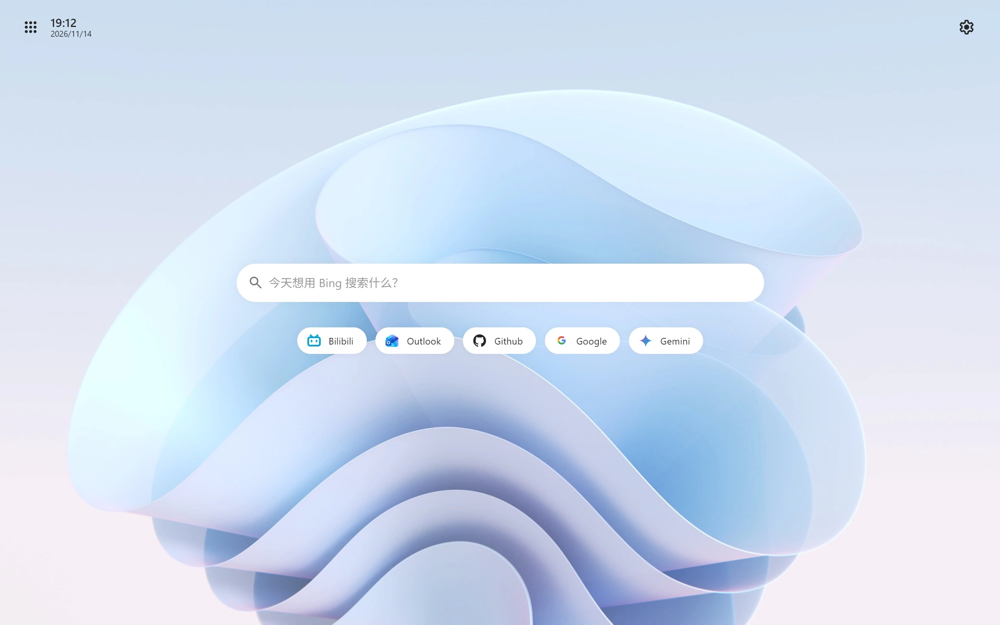
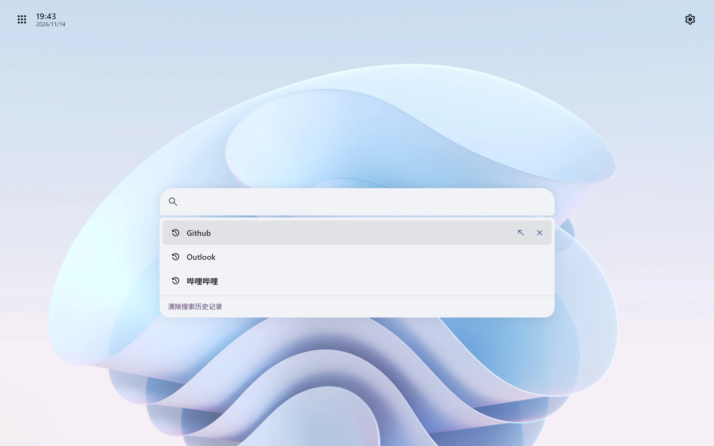
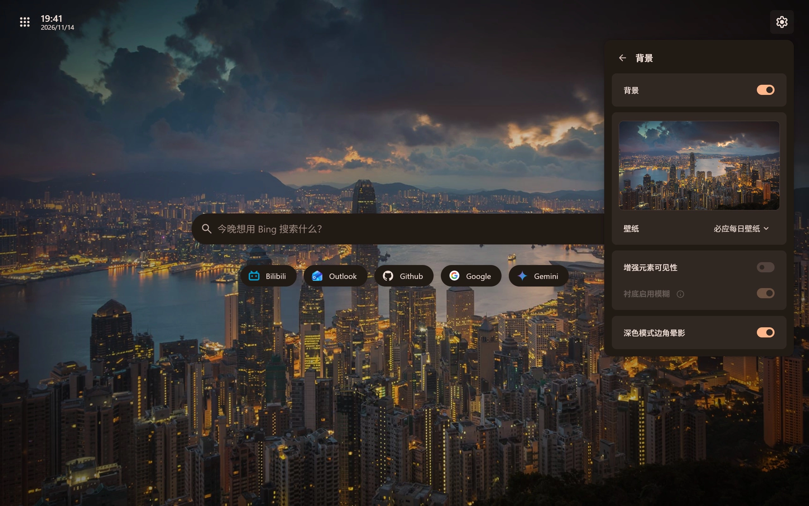

# Litestart

<strong>Cut the clutter. This time, Litestart brings you a smooth, fast, and light experience.</strong>

A customizable, native-like start page for desktop browsers.

<a href="../README.md">简体中文</a> | [<u>English</u>]
⚠ This translation may not be 100% accurate.

## Quick Start

Get or update Litestart from your browser’s extension store.

&nbsp;&nbsp;

***
Or use file import
1. Download the `.crx` or `.zip` file from [Releases](https://github.com/XingYueFox/Litestart/releases).(use `.xpi` for Firefox).
2. Open your browser’s extension management page and enable Developer Mode.
3. Drag the downloaded `.crx` or `.zip` file into the extensions page to import it.
4. Find Litestart in the extension list and enable it.
- ***If the `.crx` file won’t install, try the `.zip` archive instead.***
***

## About Litestart

- A customizable, native-like start page for desktop browsers.
- Unlike typical new tabs, there’s no extraneous online content — so it loads faster, and feels native.
- Personalization, without the speed penalty. More control, same speed.

## Features

- Search engine, logo, site navigation, search history — even where the search box sits. All up to you.
- Customize the background, search engine, and layout.
- Pin the sites you use most, right where you want them.
- Or any wallpaper you like.

## System & Browser Compatibility

- **OS**: Windows 7+ / macOS 10.15+ / Linux distributions with modern GTK 3 support.
- **Browsers**:
  - Chrome / Edge: 109+
  - Firefox: 145+
- **Supported Languages**: 简体中文 / 繁体中文 / English / Русский / 日本語

## Important Notice
*Litestart is completely free. Please only download this extension from here. The developer is not responsible for any issues caused by obtaining it from untrusted sources. 
*This page/extension is intended for learning, testing, and personal device optimization.

## License

Apache 2.0 License
